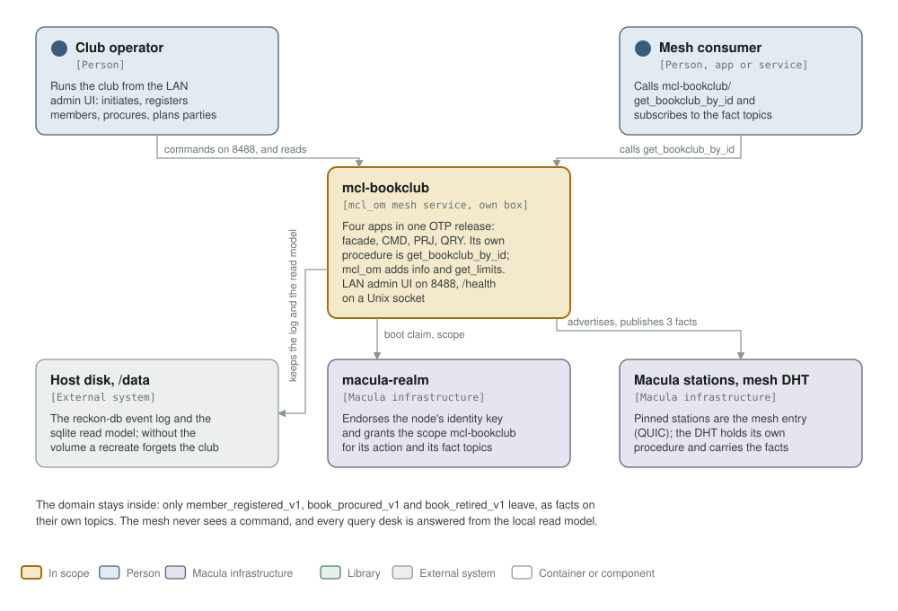
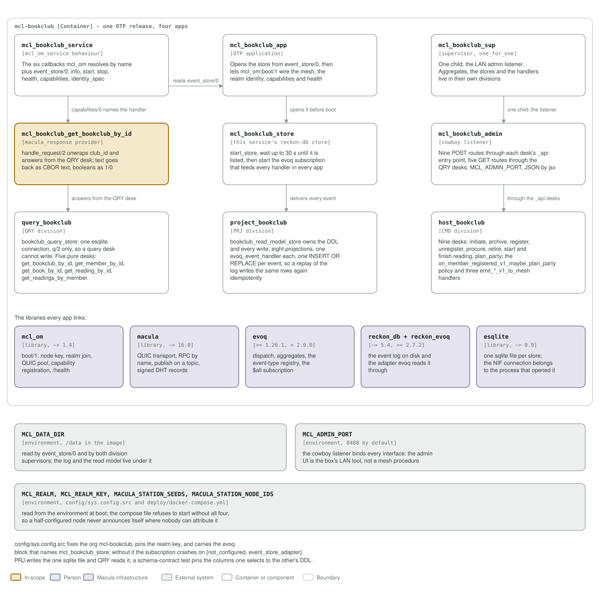

# mcl-bookclub architecture: C4 model

*This exists so a reader can see what mcl-bookclub talks to, and what it is made
of, without reading it.*

**Status: the full domain, end to end.** One OTP release holds four apps: a facade
that owns the mesh contract, a CMD division with nine desks, a policy and three mesh
emitters, a PRJ division projecting eight events into one sqlite read model, and a
QRY division answering from it. `mcl-bookclub/get_bookclub_by_id` is its own
procedure, and the only one; `mcl-om` adds `mcl-bookclub/info` and
`mcl-bookclub/get_limits` to every service, both open, and `capabilities/0` is
the list. The LAN admin UI runs on 8488; `/health` is served on a Unix socket.

## Level 1: system context

| Element | Kind | Role |
| --- | --- | --- |
| mcl-bookclub | In scope | One OTP release with four apps. Serves `mcl-bookclub/get_bookclub_by_id` on the mesh, the admin UI on 8488, and `/health` on a Unix socket |
| Club operator | Person | Runs the club from the LAN admin UI: initiates a club, registers and unregisters members, procures and retires books, starts and finishes readings, plans parties |
| Mesh consumer | Person | Another service or app on the mesh: calls `mcl-bookclub/get_bookclub_by_id` and subscribes to its fact topics |
| Host disk, `/data` | External system | Holds the reckon-db event log at `/data/mcl_bookclub_store` and the sqlite read model at `/data/bookclub.sqlite3`. Without the volume a recreate forgets the club |
| macula-realm | Macula infrastructure | Endorses the node's identity key and grants the scope `mcl-bookclub` for its action and its fact topics |
| Macula stations, mesh DHT | Macula infrastructure | The pinned stations are its mesh entry points over QUIC; the DHT holds its own procedure's advert and carries the fact topics |

The domain stays inside the service. Only `member_registered_v1`,
`book_procured_v1` and `book_retired_v1` leave, as facts on their own topics with
the club id and name in the payload; the mesh never sees a command, and every
query desk is answered from the local read model.

## Level 2: containers and components

| Component | Technology | Responsibility |
| --- | --- | --- |
| `mcl_bookclub_service` | Erlang, the `mcl_om_service` behaviour | The six callbacks `mcl_om` resolves by name at startup, plus `event_store/0`: `info/0`, `start/1`, `stop/1`, `health/0`, `capabilities/0`, `identity_spec/0` |
| `mcl_bookclub_app` | OTP application | Opens this service's own reckon-db store from `event_store/0`, then lets `mcl_om:boot/1` wire the mesh, the realm identity, capabilities and health |
| `mcl_bookclub_sup` | supervisor, `one_for_one` | One child, the LAN admin listener. Aggregates, the two stores and every handler live in their own divisions |
| `mcl_bookclub_get_bookclub_by_id` | `macula_response` RPC provider | `handle_request/2` unwraps `club_id` and answers from the QRY desk; strings go back as CBOR text and booleans as 1/0 |
| `mcl_bookclub_store` | this service's reckon-db store wiring | Starts the store, waits up to 30 s until reckon_db lists it, then starts the `evoq_store_subscription` that feeds every handler in every app |
| `mcl_bookclub_admin` | cowboy listener | Nine POST routes through each desk's `_api` entry point, five GET routes through the QRY desks. `MCL_ADMIN_PORT` (8488), JSON by jsx |
| `query_bookclub` | QRY division | `bookclub_query_store`: one esqlite connection, `q/2` only, so a query desk cannot write. Five pure desks |
| `project_bookclub` | PRJ division | `bookclub_read_model_store` owns the DDL and every write; eight projections, one `evoq_event_handler` each, one `INSERT OR REPLACE` per event, so a replay writes the same rows again idempotently |
| `host_bookclub` | CMD division | Nine desks, the `on_member_registered_v1_maybe_plan_party` policy, and three `emit_*_v1_to_mesh` handlers |
| `mcl_om` | library, `~> 1.6` | `boot/1`: loads the node key, joins the realm, opens the QUIC pool through the pinned stations, registers the declared capability and serves `/health` |
| `macula` | library, `~> 18.0` | QUIC transport, RPC dispatch to a provider by name, publishing on a fact topic, and the signed records the DHT holds |
| `evoq` | library, `>= 1.26.1, < 2.0.0` | Dispatch, aggregates, the event-type registry, and the `$all` subscription that feeds every handler |
| `reckon_db` + `reckon_evoq` | libraries, `~> 5.4` and `>= 2.7.2` | The event log on disk, and the adapter `evoq` reads it through |
| `esqlite` | library, `~> 0.9` | One sqlite file per store; a NIF connection belongs to the process that opened it |
| `MCL_DATA_DIR` | environment | Read by `event_store/0` and by both division supervisors. `/data` in the image, `<dir>/mcl_bookclub_store` and `<dir>/bookclub.sqlite3` under it |
| `MCL_ADMIN_PORT` | environment | The cowboy listener's port, 8488 in the Containerfile. It binds every interface: the admin UI is the box's LAN tool |
| `MCL_REALM`, `MCL_REALM_KEY`, `MACULA_STATION_SEEDS`, `MACULA_STATION_NODE_IDS` | environment | The realm pair comes in through `config/sys.config.src`, which relx substitutes at boot; the station seeds and node ids are read from the environment by `mcl_om` itself. The compose file refuses to start without all four, so a half-configured node never announces itself |

`config/sys.config.src` fixes the org `mcl-bookclub`, pins the realm key, and carries the `evoq` block that names
`mcl_bookclub_store`; without it the store subscription crashes on
`{not_configured, event_store_adapter}`. PRJ writes the one sqlite file and QRY
reads it, and a schema-contract test pins the columns one selects to the DDL the
other declares.

**Where the station list comes from.** It is not in `config/sys.config.src`: `mcl_om` reads `MACULA_STATION_SEEDS` and `MACULA_STATION_NODE_IDS` from the environment at boot, paired index for index, so this repository pins no station and the list may be any length.

## Drawing them

`assets/c4-context.svg` and `assets/c4-components.svg` are generated by
`architecture/c4_diagrams.py` (`python3 architecture/c4_diagrams.py`), from the
code and never from this page: the callbacks in `mcl_bookclub_service.erl`, the
boot in `mcl_bookclub_app.erl`, the store wiring in `mcl_bookclub_store.erl`, the
routes in `mcl_bookclub_admin.erl`, the three division supervisors, the
dependencies in `rebar.config`, the port and volumes in the `Containerfile` and
`deploy/docker-compose.yml`. When one of those changes, the diagram changes in the
same commit.

Two rules for the files themselves, so they render everywhere they are read
(GitHub, an IDE, `rsvg-convert`): self-contained SVG, and literal colours in plain
classes plus a `prefers-color-scheme` dark block, never CSS custom properties,
which `rsvg-convert` renders black.

The check that keeps them here is the `c4-model` job in
`.github/workflows/c4-model.yml`. It is red until both files exist and are
shown, and it stays red if either one goes missing.
